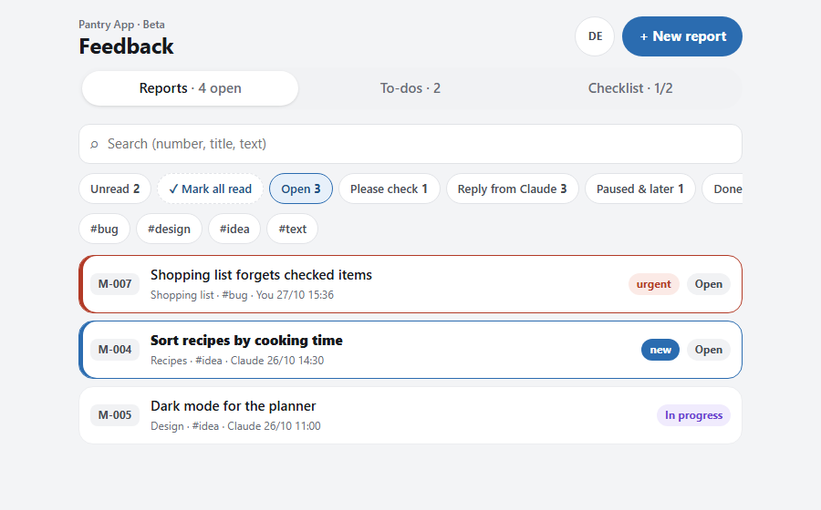
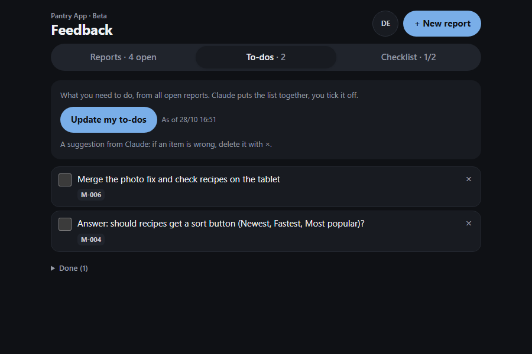
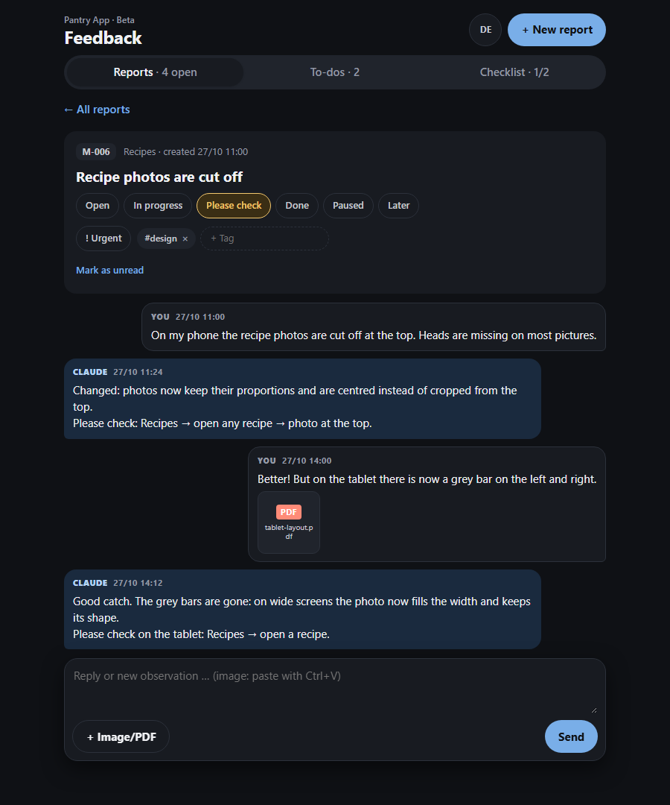

# Feedback Desk

A skill for [Claude Code](https://claude.com/claude-code) that gives you a private feedback board on claude.ai, and lets Claude work through it.

Made for people who build software with Claude but don't program themselves. Instead of explaining every bug in chat, you file it on the board: with a title, screenshots or a PDF, and an "urgent" flag if needed. Then you tell Claude **"check the feedback"**. Claude reads only what is new, fixes small things directly, asks first about bigger ones, and answers in a chat thread on each report.

*Deutsch: siehe unten.*

| The board | Your to-dos (dark mode) |
|---|---|
|  |  |



*Example data. Your board shows your own project name, areas and reports.*

## What you get

- **Reports** (M-001, M-002, …) with title, area, free tags, urgent flag, text, screenshots and PDFs (up to 20 MB).
- **Status per report:** Open → In progress → Please check → Done, plus Paused and Later. Only a person sets "Done", never Claude.
- **One chat thread per report**: you on the right, Claude on the left.
- **Unread replies stand out** (bold, marked “new”), with an “Unread” filter, “Mark all read” and “Mark as unread”. The read state follows your account across devices.
- **To-dos at one tap:** Claude reads the open reports and lists what *you* need to do (merge this, run that, check something, answer a question), duplicates merged, with checkboxes.
- **Filters** (multi-select), tags, search, and an optional **checklist** of fixed test items.
- **German and English** interface, switchable by each viewer. Light and dark mode.
- **Token-friendly:** Claude downloads only active reports into files and reads just the new messages, so long threads don't get more expensive every round.

Everything is stored in the artifact's own database on claude.ai. No extra service, no account, no cost beyond your Claude plan. The board is private until you share it.

## Requirements

- Claude Code (desktop app or CLI) with Artifacts that support a database, file uploads, viewer identity and asking Claude from the page (`db`, `assets`, `user`, `sample`). On the first visit claude.ai asks once whether the page may do the last two. The to-do button uses your own Claude plan.
- Node.js, for the small helper script Claude runs while working through the feedback.

## Install

In Claude Code:

```
/plugin marketplace add blauersamtt/feedback-desk
/plugin install feedback-desk@feedback-desk
```

Or copy the folder `skills/feedback-desk` to `~/.claude/skills/feedback-desk`.

## Use

1. **Set up:** tell Claude "set up a feedback desk". It asks for the project name, language, areas and an optional checklist, publishes the board and gives you the link.
2. **Report:** open the link signed in to claude.ai, "+ New report", paste screenshots with Ctrl+V or "+ Image/PDF".
3. **Work through it:** tell Claude "check the feedback" (or name a report, e.g. "look at M-012"). Claude answers in the thread and sets "Please check" with a click path when something changed.

ZIP files can't be attached (claude.ai's file store refuses them). Paste a link instead.

## Files

- `skills/feedback-desk/SKILL.md`: what Claude does when setting up and working through the board.
- `skills/feedback-desk/template.html`: the board itself (one HTML page, no dependencies).
- `skills/feedback-desk/scripts/desk.cjs`: picks the reports that need an answer and builds replies.
- `docs/DESIGN.md`: design decisions and what may come next.

---

## Deutsch

Ein Skill für Claude Code: ein privates Feedback-Brett auf claude.ai, das Claude selbst abarbeitet.

Gedacht für Leute, die mit Claude Software bauen, ohne selbst zu programmieren. Statt jeden Fehler im Chat zu erklären, meldest du ihn im Brett: mit Titel, Screenshots oder PDF und bei Bedarf „dringend“. Dann sagst du Claude **„schau ins Feedback“**. Claude liest nur Neues, setzt Kleines direkt um, fragt bei Grösserem zuerst und antwortet pro Meldung in einem Chat-Verlauf.

- Status: Offen → In Arbeit → Bitte prüfen → Erledigt, dazu Pausiert und Später. „Erledigt“ setzt nur ein Mensch.
- Ungelesene Antworten fallen auf („neu“), mit Filter „Ungelesen“, „Alle gelesen“ und „Als ungelesen markieren“, gleich auf allen Geräten.
- Reiter „To-dos“: Auf Knopfdruck listet Claude auf, was du tun musst, Doppeltes zusammengefasst, zum Abhaken.
- Filter mit Mehrfachauswahl, Tags, Suche, optionale Checkliste.
- Oberfläche Deutsch und Englisch, umschaltbar. Hell und dunkel.
- Alles liegt in der eigenen Datenbank des Artifacts auf claude.ai. Keine zusätzlichen Dienste oder Kosten.

**Installieren:** in Claude Code `/plugin marketplace add blauersamtt/feedback-desk`, dann `/plugin install feedback-desk@feedback-desk`.

**Einrichten:** „Feedback-Tool einrichten“ sagen. **Abarbeiten:** „schau ins Feedback“ sagen.

## License

MIT
